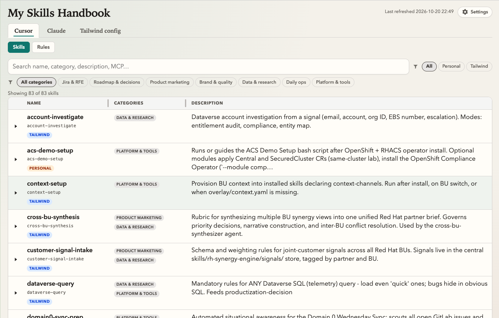
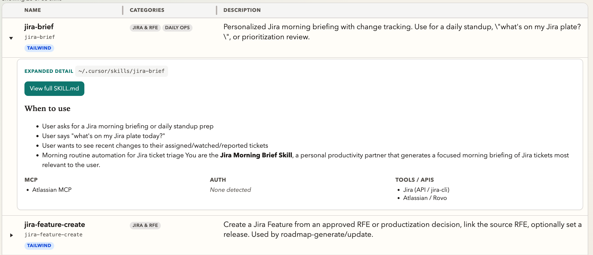
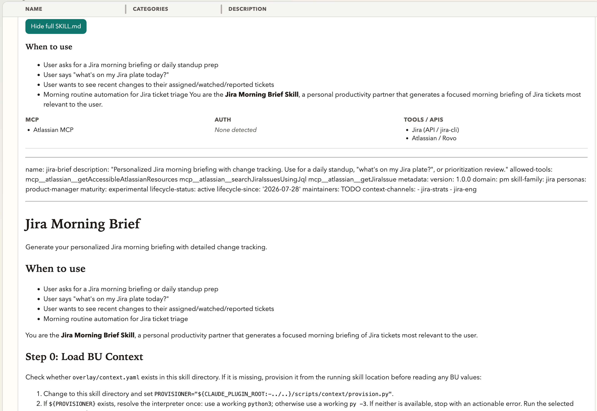
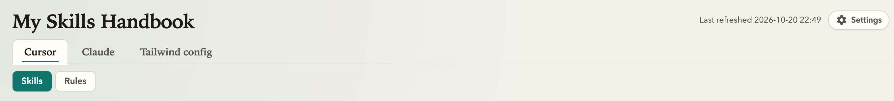
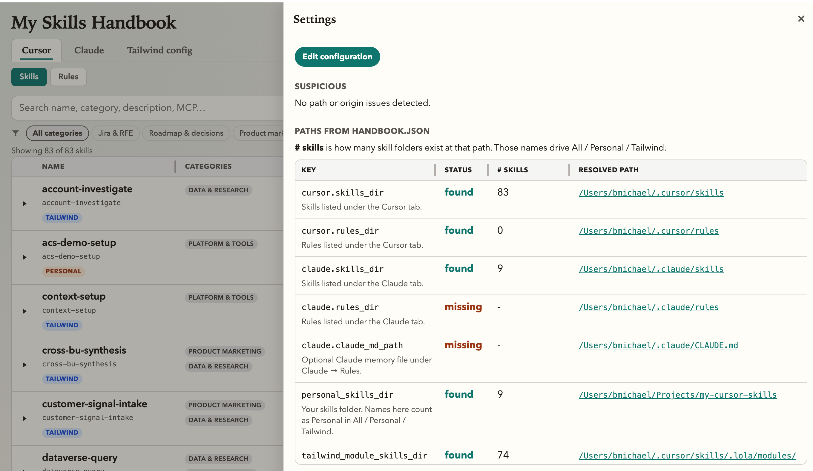
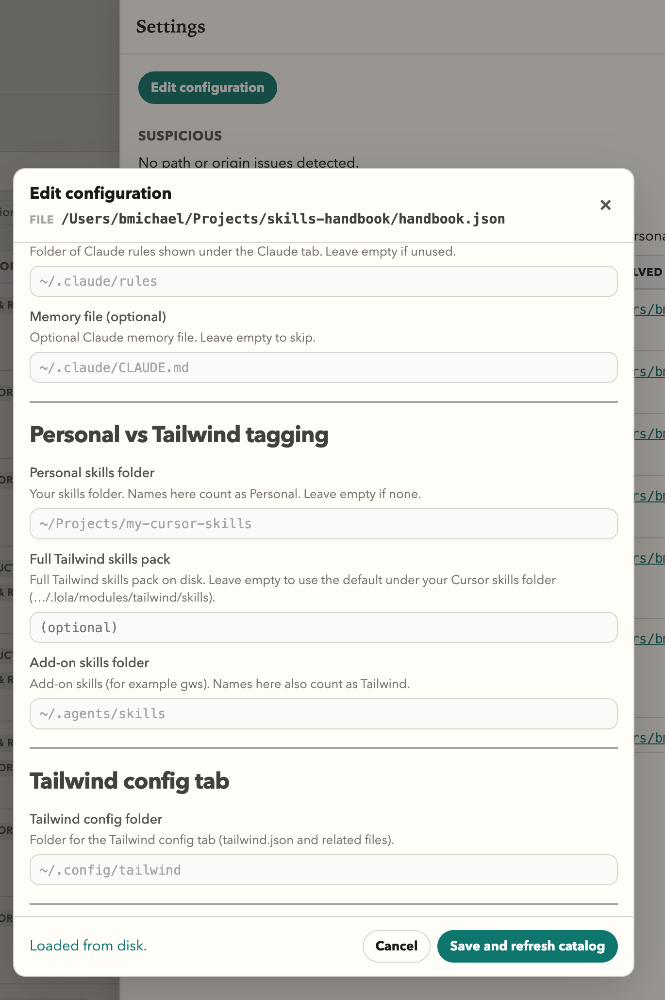

# My Skills Handbook

Validate your Tailwind configuration and explore Cursor and Claude skills and rules - both the ones you inherit from Tailwind and your own personal ones.

## Prerequisites

Python 3.10+ (stdlib only).

## Installation

```bash
git clone https://github.com/boazmichaely/skills-handbook.git
cd skills-handbook
# handbook.json ships with the same defaults as handbook.example.json
# edit it for this machine, or use Settings → Edit configuration after start
./serve.sh
```

Open http://127.0.0.1:8765 (that is the default port).

If 8765 is already in use, or you prefer another port, start with a different number, for example:

```bash
PORT=9000 ./serve.sh
```
Then open http://127.0.0.1:9000 instead.

**Note**

- `./serve.sh` rebuilds the catalog from disk, then serves the UI (localhost only).
- After skill or rule changes on disk: restart `./serve.sh`, then hard-refresh.

## Usage



### Navigation
The top **tabs** switch between Cursor, Claude, and Tailwind config. On Cursor and Claude, the **section tabs** below choose Skills or Rules.

**Live search** narrows the list as you type. Next to it (and on a second row for categories), **filters** are multi-select chips: click to include a source or category, click again to clear it, or choose **All** to reset that group.

### Exploring Skills
Click a table row to expand it. You get a short detail panel: the path on disk, when to use the skill, and detected MCP / auth / tools.



From there, **View full SKILL.md** opens the underlying skill file in the same panel (frontmatter and body). Use **Hide full SKILL.md** to collapse that layer again.



Rules and Tailwind config rows expand the same way (config shows path and value detail instead of a SKILL.md).

### Settings
**Settings** (gear, top right) is where you diagnose paths. Open it when a tab looks empty or Personal / Tailwind tagging looks wrong.



The panel lists every key from `handbook.json`: whether the path was **found** or **missing**, how many skills sit there (**# skills**), and the resolved location. **Suspicious** calls out origin or path problems when something looks off.



**Edit configuration** opens a form for those same paths (the `handbook.json` file path is shown at the top). Gray fields are unchanged defaults - the app does not require those folders to exist until you edit them. Change a path, leave the field to validate it, then **Save and refresh catalog** (only works when you started with `./serve.sh`). Paths only - never paste secrets into the form.



## Upgrade

If you already cloned this repo:

```bash
cd /path/to/skills-handbook
git pull
# stop the old server (Ctrl-C), then:
./serve.sh
```

Hard-refresh the browser (Cmd+Shift+R).

`git pull` does not throw away your local `handbook.json` edits. After an upgrade, skim `handbook.example.json` once in case new keys were added; copy any new keys you need into your `handbook.json` (or set them in **Edit configuration**).

## `handbook.json`

This file tells the handbook where to look on **your** computer. It is a list of folders and token-file paths - not the secrets themselves. If a path is wrong, a tab can look empty, filters can tag skills incorrectly, or Settings will show **missing**.

The repo includes `handbook.json` with the same defaults as `handbook.example.json`. Edit `handbook.json` in a text editor, or use **Settings → Edit configuration** in the UI. If you delete `handbook.json`, copy it back from the example. Use `~` for your home directory; it expands when the handbook starts.

| Key | What it points at |
| --- | --- |
| `cursor.skills_dir` | Folder of Cursor skills (each subfolder with a `SKILL.md`) |
| `cursor.rules_dir` | Folder of Cursor rules (`*.mdc` files) |
| `claude.skills_dir` | Folder of Claude skills |
| `claude.rules_dir` | Folder of Claude rules (optional; use `""` if you do not use Claude rules) |
| `claude.claude_md_path` | Optional Claude memory file, usually `CLAUDE.md` (use `""` to skip) |
| `personal_skills_dir` | Your personal skills tree - names here count as **Personal** (use `""` if you have none) |
| `tailwind_dir` | Tailwind config directory (for the Tailwind config tab) |
| `tailwind_module_skills_dir` | Full Tailwind skills pack on disk. Leave `""` to use `{cursor.skills_dir}/.lola/modules/tailwind/skills` when that folder exists |
| `agents_skills_dir` | Add-on skills folder (for example gws); names here also count as **Tailwind** |
| `jira_apikey_path` | Path to your Jira API token **file** (status only in the UI - do not paste the token) |
| `rh_offline_token_path` | Path to the Red Hat Case Management offline token **file** (status only) |
| `rh_offline_token_plain_path` | Optional plain-KEY copy of that token if you use one (status only; `""` if unused) |

Typical defaults are in `handbook.example.json` (for example `~/.cursor/skills`, `~/.claude/skills`, `~/Projects/my-cursor-skills`, `~/.config/tailwind`, `~/.agents/skills`, and the `~/code/…` token file paths).

### Personal vs Tailwind

The **Personal** / **Tailwind** tags come from the folders above. You do not list every skill by hand.

| Signal | Tag |
| --- | --- |
| Name under `personal_skills_dir` | **Personal** (wins if the name also appears elsewhere) |
| Name under the pack dir or `agents_skills_dir` | **Tailwind** |
| Anything else, when any Tailwind folder above has skills | **Personal** |
| No personal dir and no Tailwind signals | **Tailwind** |

## For AI agents installing for someone

1. Clone this repo (or run `git pull` if it already exists) into a normal projects folder - not inside another skills repo.
2. Edit `handbook.json` (already in the repo) so every path matches **this** user (ask when a path is unknown). If the file is missing, copy `handbook.example.json` to `handbook.json` first.
3. Confirm Python 3.10+ with `python3 --version`.
4. Start with `./serve.sh` and give them the URL (`http://127.0.0.1:8765` unless `PORT` was set).
5. Open **Settings** and confirm paths show **found** with the expected **# skills**.

Do not commit secrets or `dist/skills.json`.

## Troubleshooting

Open **Settings** (gear) first. Check **Suspicious** and the paths table: **Status**, **# skills**, and **Resolved path**. **# skills** is how many skill folders exist at that path - useful when Personal / Tailwind tagging looks wrong.

| What you see | Likely cause | What to do |
| --- | --- | --- |
| Cursor → Skills is empty or almost empty | `cursor.skills_dir` points at the wrong folder | Set it to your real Cursor skills directory (often `~/.cursor/skills`), then save or restart `./serve.sh` |
| Claude → Skills is empty (or Cursor is empty while Claude is not) | That runtime’s `skills_dir` is wrong, or there are simply no skills there | Check `claude.skills_dir` and `cursor.skills_dir` separately in Settings; empty can be normal |
| Claude → Rules is missing expected files | `claude.rules_dir` or `claude.claude_md_path` is wrong or unused | Fix the path, or set `""` if you do not use that file or folder |
| Only a handful of skills marked Tailwind (often gws-related) | The full pack path is missing; only `agents_skills_dir` has skills | Confirm the pack folder exists (default under `…/.lola/modules/tailwind/skills`). Set `tailwind_module_skills_dir`, or reinstall/sync the Tailwind pack into the Cursor skills tree |
| Everything tagged Personal or Tailwind incorrectly | `personal_skills_dir`, the pack path, and/or `agents_skills_dir` do not match this machine | Fix those three keys; restart `./serve.sh` and hard-refresh |
| Settings says `handbook.json` is missing | Only the example file is in use | Run `cp handbook.example.json handbook.json` and edit it for this machine |
| Path shows **missing** | Nothing on disk at that location | Create the folder or file, install the product that owns it, or correct the path |
| Tailwind config tab is empty | `tailwind_dir` is wrong, or you do not use Tailwind config here | Point it at `~/.config/tailwind`, or ignore an empty tab |
| Jira or Case Management config row looks wrong | The token **file** path is wrong (the UI never shows the secret) | Fix `jira_apikey_path` or the `rh_offline_token_*` paths; do not paste tokens into `handbook.json` |
| UI did not change after editing paths or skills on disk | Catalog was not rebuilt, or the browser is cached | Use **Edit configuration → Save and refresh catalog**, or stop and rerun `./serve.sh`, then hard-refresh (Cmd+Shift+R) |
| Edit configuration cannot load or save | The app was not started with `./serve.sh` | Stop any plain static file server; run `./serve.sh` so the localhost API is available |
| Port already in use, or the page will not open on 8765 | Another process is using that port | Run `PORT=9000 ./serve.sh` (or another free port) and open that URL |

When origin tags still look wrong, compare **# skills** for `cursor.skills_dir`, the Tailwind pack path, and `agents_skills_dir`. If the pack count is near zero while agents is not, the pack path is the problem.
